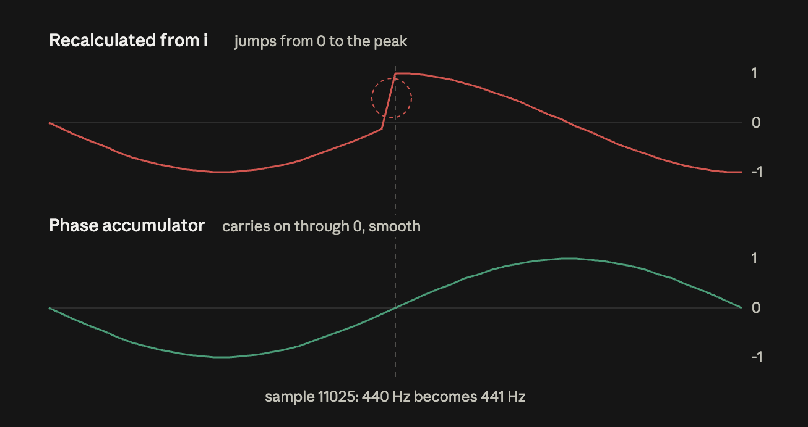

# MINISYNTH

## introduction

### goal

build a small synthesizer written in C++ using only the standard library, rendering multi-note, enveloped stereo audio from notes typed on the command line to a WAV file. real-time playback is an optional extension.

### checklist

- [x] **WAV file generator:** synthesize a sine wave tone and write it to a 16-bit mono WAV file using only the C++ standard library
- [x] **CLI tool:** split the code into functions and files, and set frequency, duration and output path via command-line arguments. add extensive error checks
- [x] **oscillators:** generate sine, square, saw, triangle and noise waveforms using a phase accumulator
- [ ] **sequencer:** render a sequence of notes passed on the command line, with ADSR envelopes, stereo panning and mixing
- [ ] **interactive mode (optional):** choose options through simple prompts as an alternative to command-line arguments, reusing the existing checks
- [ ] **real-time playback (optional):** play the synth live through the speakers using a callback-based audio API

### file structure

- the primary program file is `minisynth.cpp`
- `wav_file.cpp` and `wav_file.h` create the WAV file
- `tone_generator.cpp` and `tone_generator.h` generate the sound samples
- `options.cpp` and `options.h` read and check CLI inputted user options
- `waveform.cpp` and `waveform.h` create the waveforms
- `/examples` contains code that explains relevant concepts

## commands

### run minisynth

- with defaults: `make run-minisynth`
- with arguments: `make run-minisynth ARGS="-f 440 -d 2.5 -o a440.wav -w sine"`

#### usage

`minisynth [-f|--frequency HZ] [-d|--duration SECONDS] [-o|--output PATH] [-w|--waveform NAME]`

#### options

all options are optional; any you leave out use their default. options can be given in any order.

- `-f` or `--frequency`: tone frequency in Hz, from 1 to 20000, decimals allowed | (default: 528)
- `-d` or `--duration`: length in seconds, from 0.5 to 60, decimals allowed | (default: 3)
- `-o` or `--output`: output file path, must either have no extension (`.wav` is added) or end in `.wav` (any capitalisation) | (default: `tone.wav`)
- `-w` or `--waveform`: waveform: sine, saw, square, triangle or noise | (default: sine)

#### errors

- if an option or value isn't valid, minisynth prints an error and, for option errors, the usage line, and exits without writing a file
- see error reference at end of README for a full list of checked errors

### check generated file size

`ls -la tone.wav`

### run pass-by-value-vs-reference experiment

`make run-pass-by-value-vs-reference`

### run command-line-arguments

`make examples/command-line-arguments && ./examples/command-line-arguments hello 440 2.5`

### clean output files

`make clean`

## notes

### code structure

- there is no hoisting in C++, code is read from top to bottom, so functions must be defined above the code that calls them
- declarations pasted in at the top of a file make functions known before any code that calls them (see below)

### source and header files

**compiling and linking**

- each .cpp is compiled alone, so the compiler only knows of functions it's seen declarations for
- #including "headers" pastes in these declarations so the compiler can check even though the code is in other files
- the linker connects those calls to the definitions in the other object files

**source files**

- .cpp source files hold the definitions - the code behind the declarations
- every source .cpp with a header #includes it, so the compiler helps catch mismatches between definitions and declarations
- if an included header (e.g. `<cstring>`) is only used in a function body in the .cpp file and not in the .h, put it only in the .cpp

**header files**

- a .h header file is the export list of its header/source pair: types plus declarations, with no function bodies
- `minisynth.cpp` has no header file, because nothing calls main: a header is only needed for things other files use
- it’s a single source of truth: one copy of the WavHeader struct, so other files can’t disagree about its layout
- include everything that the function declarations and types use
- even if a file gets its includes through the included headers, it's good practice to add every include that you need in case there are changes to the other file

### const variable declarations

- const means the value can't be changed
- any value that doesn't change after the variable is created could be a const
- eg frequency, amplitude but not samples, i in `generateTone`
- whether to mark everything possible as const is a style choice

### pass by value and references

- C++ copies arguments by default: the function gets its own copy (pass by value)
- `&` after a type makes a parameter a reference: no copy, the function works on the caller's original
- `const &` makes the reference read-only, so you get no copy and no accidental changes
- small types (`int`, `float`) are fine to pass by value; bigger things the function only reads (vectors, strings, structs) are usually passed by `const &`
- see `examples/pass-by-value-vs-reference.cpp`

### Makefile

```make
greeting: hello.cpp
	clang++ hello.cpp -o greeting
```

"to make `greeting`, you need `hello.cpp`, and here's the command"

- **target** (`greeting`): usually the file the recipe creates; for a `.PHONY` target, just a name for an action
- **prerequisites** (`hello.cpp`): the files the target depends on; the recipe only runs if the target is missing or a prerequisite is newer than it
- **recipe** (the indented line): the command that creates the target; must be indented with a tab, not spaces
- `make` builds the first target in the file; `make <target>` builds a specific one

### why std::stof takes an address

```
std::size_t charactersRead = 0;
frequency = std::stof(frequencyValue, &charactersRead);
```

a function only has one return type, already used for the number (stored in `frequency`) so the count needs to come back another way. using `&charactersRead` writes directly to `charactersRead` rather than copying it (an "output parameter" - function writes to, rather than reads from, it). we use an address rather than a reference because it can also be "nothing" (a null pointer), making the parameter optional. 

### the blockAlign issue explained

- *why an odd number of bytes is a problem:* every sample is an `int16_t` which is 2 bytes. so the audio data is always 2 x number of samples, an even number. an odd number of bytes means “some whole samples, plus 1 extra byte”. 1 byte is half a sample, which doesn't exist, so that extra byte doesn't correspond to anything.
- *the header calculation:* in `wavfilegenerator`'s `createWavHeader` we worked out the number of bytes by `byteRate × duration`. `byteRate` is `2 * sampleRate` (see previous point), so essentially the number of bytes is worked out as `(2 * sampleRate) * duration`. with some decimal durations, this can lead to an odd number of bytes, e.g. `(2 * 44,100) × 1.00002 = 88,201.76`. we chop off the decimal and have an odd number: `88,201`. in `wavfilegenerator` we had a set duration of 3 seconds, so this was not a problem. but in `minisynth` the user can input decimal values for the duration. 
- *the generateTone calculation:* in `generateTone` the actual sample data is worked out differently: `sample rate x duration`. using the same calculation as above we get `44,100 × 1.00002 = 44,100.88`. _then_ we chop off the decimal, leaving us with `44,100`. how much actual space this takes up will always be this final number x 2, because as we know each sample takes up two bytes, and this will always be an even number. in our example, `2 x 44,100 = 88,200`
- *the problem:* now the header's audio data value of `88,201` doesn't match the actual audio data of `88,200`. writeFile now writes one byte more than the `samples` vector  created in `generateTone`actually holds, causing a memory bug.
- *the solution:* we work out the audio data in the `createWavHeader` the same way as we do in `generateTone`, by calculating the number of samples first: `uint32_t numSamples = header.sampleRate * durationSeconds;`then using this number in the subchunk2Size (audio data size) calculation, so `header.subchunk2Size = (header.byteRate) * durationSeconds` becomes `header.blockAlign * numSamples`. 

### object lifecycles and RAII (resource acquisition is initialization)

- `std::ofstream outputStream(...)` creates an *object*: an instance of a standard library class, which bundles data and functions (like `.write()`)
- a class can have a *constructor*, which runs automatically when the object is created (`std::ofstream`'s opens the file), and a *destructor*, which runs automatically when it's destroyed (`std::ofstream`'s closes the file)
- an object, like a variable, is destroyed when its scope ends: at the closing brace, or on any `return` out of the function (e.g. our `if (!outputStream)` checks)
- "destroyed" refers to the `outputStream` object (the variable), not the WAV file on disk, which stays
- so `outputStream` is always closed when `writeFile` ends, however it ends, and `outputStream.close()` isn't needed (it only exists to close a file earlier than the end of its scope)
- RAII = tying cleanup to an object's lifetime, so it happens automatically and can't be forgotten
- `std::vector` and `std::string` work the same way: their destructors free their memory, which is why we never free it ourselves

### phase accumulator explained

- for minisynth, we have refactored the tone generator into a phase accumulator. this allows for smooth pitch transitions and provides us with a single engine that multiple waveform functions can use
- *phase*: how far through one cycle we are, measured from 0 through 1. for a sine wave, 0.25 is the peak and 0.75 is the trough
- in _wave file generator_ we are counting every cycle, so 122.25 says we have completed 122 cycles and are at the peak of the current cycle, but the only important information to us is where we are in the current cycle
- *the original formula*: `phase = frequency × i / sampleRate`
- `i / sampleRate` is `time` - if there are 44100 samples in a second, and we are at sample (i) 22050, then we are at 0.5 seconds
- `frequency * time` is how many cycles we have thus far completed, so `440 * 0.5s` is `220` cycles
- we then turned this position into sound using the formula `sin(2π × phase)`. this says how high the wave is, at the given phase point in the cycle (phase). in this case this bends the previously straight and rising phase line into a curve, creating a sine wave
- *the phase accumulator: phase increment*: to start, we want to ask ourselves _how many cycles are there in a sample?_ we work this out by dividing the frequency by the sample rate - so if, in theory, the frequency is 2 (2 cycles per second) and the sample rate is 8 (8 samples per second, our "resolution"), then we have `2 / 8 = 0.25` cycles per sample. this number is called our *phase increment*. for every sample, the phase will increment by 0.25, and each time it does increment we want to provide a number that will tell us where we are in the wave
- *the phase accumulator:* whereas before we were counting every cycle (our example being 122.25), the phase accumulator will only keep the position in the current cycle. it does this by:
    1. outputting the wave at the current phase
	2. adding the increment
	3. subtracting 1 if the phase has reached one or more (it "wraps")
- we can see the difference using JS code as examples:

 ```javascript
// A: work it out from the loop index every time
for (let i = 0; i < 5; i++) {
  const height = 20 * i;
  console.log(height);
}

// B: keep a running total
let height = 0;
for (let i = 0; i < 5; i++) {
  console.log(height);
  height += 20;
}
```

- the new method is better because it prevents a sharp jump in the wave which can lead to clicks. in example A, if you change the step height to 25cm, it calculates as if it had always been 25cm, so you see a large leap in the total height. in example B, the change happens from when the change was made. an example using real audio numbers:
    - 440 Hz: `440 × 0.25s (sample 11025) = 110.00 cycles`, so the position is 0, and the sample value is 0
    - At 441 Hz: `441 × 0.25s (sample 11025) = 110.25 cycles`, so the position is 0.25, which is the peak - we jump quickly from 0 to peak, causing a click



- two smaller benefits: firstly, because we are always subtracting 1 when we complete a cycle, it means we are always dealing with small numbers, less than 1 in fact. with a large audio file, the number of cycles can balloon to vast numbers. secondly, we now have one engine that all the waveforms can use

### waveform formulas

- *sine*: `sin(2π × phase)` -> how high are we, at a given point around a circle? `* 2π` converts into the units required by `sin()`, a bit like `* 360` for degrees
- *saw*: `a + (b - a) × t` -> a straight line that resets back to -1 height at phase cycle completion. formula calculation is where you started (`a`), plus the total trip (`b - a`) - `b` being where you end - times progress, how much of the trip you’ve done (`t`)
- *triangle*: `if (phasePosition < 0.5) { return -1 + (1 - -1) * (phasePosition * 2); }` -> for the first half of the cycle we copy the straight line saw formula, but we `* 2` because something that lasts half as long finishes twice as fast. we are halving the time the formula covers, so to do this we need to double the progress | `return 1 + (-1 - 1) * ((phasePosition - 0.5) * 2);` -> at the beginning of the second half, the downward slope, the phase is now at `0.5`, but we want to start counting from `0` so we subtract `0.5` then perform the same doubling as the first half. note that the start and end numbers have changed too. `a`, starting point, is now `1` because we are starting at `1`, the peak of the waveform. `b` is now `-1` as that's where we want to end up. we've reversed the slope.
- *square*: `if (phasePosition < 0.5) { return 1.0; } return -1.0;` -> for the first half of the cycle max height, for the second half min height
- *noise*: a random height on every sample, no phase involved. the generator is created once, outside `waveformValue`. if it was inside `waveformValue`, it would be created new for each sample, and so each sample would be given the first number in the predetermined sequence, creating a straight line - silence


### waveform debugging

- place the following if clause in the tone generator, inside the loop, after `samples[i]` is written:

```cpp
if (i == 10 || i == 30 || i == 60 || i == 90) {
	std::cout << i << ": " << samples[i] << "\n";
}
```

- run the program with `-f 441` and any waveform. 441Hz is exactly 100 samples per cycle, with our given sample rate of 44100. with checks at 10, 30, 60 and 90 we are checking the height in the middle of each quarter in the cycle, away from the jump points. we can compare the cout print to our expected values to gauge the success of our formula:

| waveform | i = 10 | i = 30 | i = 60 | i = 90 |
|---|---|---|---|---|
| sine | 5877 | 9510 | -5877 | -5877 |
| saw | -8000 | -4000 | 2000 | 8000 |
| square | 10000 | 10000 | -10000 | -10000 |
| triangle | -6000 | 2000 | 6000 | -6000 |
| noise | random, but identical every run | | | |

- note that being off by 1 is fine because of truncation (9.9999999 becomes 9, not 10)

### float vs double

- a double has about twice as many digits as a float, making rounding errors smaller
- in `double phaseIncrement = static_cast<double>(frequency) / static_cast<double>(sampleRate);` we convert the inputs to avoid minor rounding errors, as a calculation’s type is decided by its inputs, not the variable you store it in
- we only need a cast on one side as C++ converts other side to match, but both have been left in for clarity

### variable data flow reference

- `durationSeconds`: we are using an existing variable, hence no type declaration
- `createWavHeader()` returns the *value* of its own "header" variable (which then disappears),
- then we store it in a NEW "header" variable here, for use in the following functions

### evaluation explanation

- example: `if (!(i+1 < argc && argv[i + 1][0] != '-'))`
- we evaluate the inner brackets first
- if `i+1 < argc` is `false`, it means there is no next argument, the value is missing
- the evaluation is "short circuited", so the rest of the expression doesn't evaluate, so the inner brackets in total evaluate to `false`
- the `!( .. )` _flips_ this to `true`, so the if block runs
- if `i+1 < argc` is `true`, we then check the right hand side of the expression
- if `argv[i + 1][0] != '-'` is `false`, it means there is a leading `-`, so it's an option not a value
- the inner brackets again evaluate to `false`, which is again flipped by the wrapping `!( .. )` to `true`, again running the if block
- if `argv[i + 1][0] != '-'` is `true`, then the inner brackets return true. this is flipped to `false` by the `!( .. )`, so we skip the if block

### error messages reference

- unknown option: --volume
- missing value for --frequency
- value without an option: 440
- --frequency given more than once
- invalid frequency: banana
- frequency must be between 1 and 20000 Hz: 25000
- invalid duration: abc
- duration must be between 0.5 and 60 seconds: 90
- output path cannot be empty
- output path must end in .wav or have no extension: tone.mp3
- could not write file: nofolder/440.wav
- unknown waveform: banjo

### tests

run each with `make run-minisynth ARGS="..."` (the first one with no ARGS). every error except "could not write file" also prints the usage line. no error writes a file.

**key test cases**

| checks | ARGS | expected output |
|---|---|---|
| defaults | *(none)* | `wrote tone.wav` |
| all options | `-f 440.5 -d 2.5 -o a440 -w square` | `wrote a440.wav` |
| missing value | `-f -d 2.5` | `missing value for -f` |
| unknown option | `--volume 5` | `unknown option: --volume` |
| value without option | `440` | `value without an option: 440` |
| duplicate | `-f 440 --frequency 880` | `--frequency given more than once` |
| invalid number | `-f 440abc` | `invalid frequency: 440abc` |
| negative value | `-d -5` | `duration must be between 0.5 and 60 seconds: -5` |
| bad extension | `-o tone.mp3` | `output path must end in .wav or have no extension: tone.mp3` |
| write failure | `-o nofolder/tone` | `could not write file: nofolder/tone.wav` |
| unknown waveform | `-w banjo` | `unknown waveform: banjo` |

**all test cases**

| area | ARGS | expected output |
|---|---|---|
| defaults | *(none)* | `wrote tone.wav` |
| all options | `-f 440 -d 2.5 -o a440` | `wrote a440.wav` |
| long forms | `--frequency 440 --duration 2 --output a440.wav` | `wrote a440.wav` |
| any order | `-o a440 -d 2 -f 440` | `wrote a440.wav` |
| structure | `-f` | `missing value for -f` |
| structure | `-f -d 2.5` | `missing value for -f` |
| structure | `--volume 5` | `unknown option: --volume` |
| structure | `440` | `value without an option: 440` |
| structure | `-f 440 300` | `value without an option: 300` |
| duplicates | `-f 440 -f 880` | `-f given more than once` |
| duplicates | `-f 440 --frequency 880` | `--frequency given more than once` |
| duplicates | `-d 1 -o a.wav -d 2` | `-d given more than once` |
| duplicates | `-o x.wav --output y.wav` | `--output given more than once` |
| frequency | `-f 440.5` | `wrote tone.wav` |
| frequency | `-f 1` | `wrote tone.wav` (lowest allowed) |
| frequency | `-f 20000` | `wrote tone.wav` (highest allowed) |
| frequency | `-f banana` | `invalid frequency: banana` |
| frequency | `-f 440abc` | `invalid frequency: 440abc` |
| frequency | `-f 1e999` | `invalid frequency: 1e999` (too big for a float) |
| frequency | `-f 0.5` | `frequency must be between 1 and 20000 Hz: 0.5` |
| frequency | `-f 25000` | `frequency must be between 1 and 20000 Hz: 25000` |
| frequency | `-f -5` | `frequency must be between 1 and 20000 Hz: -5` |
| frequency | `-f nan` | `frequency must be between 1 and 20000 Hz: nan` |
| frequency | `-f inf` | `frequency must be between 1 and 20000 Hz: inf` |
| duration | `-d 0.5` | `wrote tone.wav` (lowest allowed) |
| duration | `-d 60` | `wrote tone.wav` (highest allowed) |
| duration | `-d abc` | `invalid duration: abc` |
| duration | `-d 0.2` | `duration must be between 0.5 and 60 seconds: 0.2` |
| duration | `-d 90` | `duration must be between 0.5 and 60 seconds: 90` |
| duration | `-d -5` | `duration must be between 0.5 and 60 seconds: -5` |
| blockAlign | `-d 1.00002` | `wrote tone.wav`, and `ls -la tone.wav` shows 88244 bytes |
| output | `-o a440` | `wrote a440.wav` |
| output | `-o a440.wav` | `wrote a440.wav` |
| output | `-o a440.WAV` | `wrote a440.WAV` |
| output | `-o ./tone` | `wrote ./tone.wav` |
| output | `-o` | `missing value for -o` |
| output | `-o tone.mp3` | `output path must end in .wav or have no extension: tone.mp3` |
| output | `-o my.song` | `output path must end in .wav or have no extension: my.song` |
| output | `-o ""` (use `ARGS='-o ""'`) | `output path cannot be empty` |
| writing | `-o nofolder/tone` | `could not write file: nofolder/tone.wav` |
| waveform | `-w sine` | `wrote tone.wav` |
| waveform | `-w saw` | `wrote tone.wav` |
| waveform | `-w square` | `wrote tone.wav` |
| waveform | `-w triangle` | `wrote tone.wav` |
| waveform | `-w noise` | `wrote tone.wav` |
| waveform | `--waveform saw` | `wrote tone.wav` |
| waveform | `-w SQUARE` | `wrote tone.wav` |
| waveform | `-w banjo` | `unknown waveform: banjo` |
| waveform | `-w Banjo` | `unknown waveform: Banjo` |
| structure | `-w` | `missing value for -w` |
| duplicates | `-w sine --waveform sine` | `--waveform given more than once` |
| any order | `-o a440 -w sine` | `wrote a440.wav` |
| any order | `-w sine -o a440` | `wrote a440.wav` |

### known limitations

**endianness**

- little-endian machines store the lowest byte first. big-endian the largest. WAV format requires little-endian. most machines these days write using little-endian so that's ok, but for machines that write big-endian we need to write some extra functions. fortunately this does not affect any common machine today
- I'm parking this for the time being, until I can approach it with a better understanding of how bytes are stored, allocated and read, and how the conversion/re-write works.

**aliasing**

- instant jumps in height in the square and saw waveforms (when they go, for example, from 1 to -1) create overtones at high frequencies that the sample rate can't represent. instead of disappearing, these are folded down as harsh inharmonic overtones. this requires band-limited waveforms to be fixed, so for now I'm parking it
